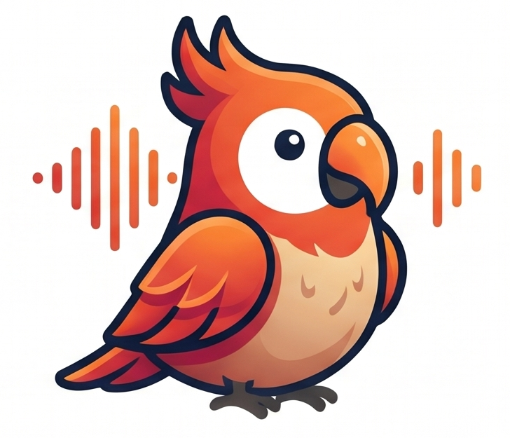

<h1 align="center">VoicePrompt</h1>

단축키를 누르고 말하면, 커서가 있는 곳에 글이 입력됩니다.

macOS · Windows Preview · 로컬 음성 인식 · API 키와 구독 불필요

**[앱 다운로드](https://github.com/mjeon01/voiceprompt/releases)** · [사용 안내](docs/USAGE.md) · [비용과 자원 사용량](docs/COSTS.md) · [유지보수](docs/MAINTENANCE.md) · [데이터 처리](docs/PRIVACY.md)

## 무엇을 하나요

- `Ctrl + Shift + Space`로 녹음을 시작하고, 다시 눌러 완료합니다.
- 말하는 동안 인식 중인 문장을 미리 보여 줍니다. 속도는 기기와 모델에 따라 달라집니다.
- 시작할 때의 입력 대상을 확인한 뒤 글을 입력합니다. 자동 입력이 불가능하면 결과를 복사할 수 있습니다.
- Enter를 누르거나 메시지를 전송하지 않습니다. 전송 전 내용을 직접 확인하세요.
- Qwen·Ollama 등 개발 용어에 인식 힌트를 주고 일부 표기를 보정합니다. 설정에서 끌 수 있습니다.

## 지원 범위

| | macOS | Windows |
|---|---|---|
| 배포 버전 | 0.4.1 | 0.5.0-preview.1 |
| 대상 | Apple Silicon, macOS 14 이상 | Windows 11 x64, AVX2·FMA·F16C 지원 CPU |
| 인식 엔진 | WhisperKit 1.1.1 / Core ML | Whisper.net 1.9.1 / whisper.cpp CPU |
| 모델 | Whisper large-v3 turbo | Whisper small 다국어 |
| 최초 모델 다운로드 | 로컬 설치 약 1.53 GiB, 다운로드 크기는 구성에 따라 다름 | 487,601,967 bytes, 약 465 MiB |
| 사용 권한 | 마이크·손쉬운 사용 | 데스크톱 앱 마이크 접근 |
| 자동 입력 | 원래 앱·창을 확인한 뒤 붙여넣기, 클립보드 복원 시도 | 원래 창·입력 요소를 확인한 뒤 유니코드 키 입력 |
| 취소 | `Esc` | `Ctrl + Shift + Esc` 또는 취소 버튼 |
| 현재 검증 범위 | 기존 Mac 사용 및 회귀 검사 | Windows 빌드·UI·CPU 추론 검사 통과, 실사용은 Preview |

두 플랫폼의 모델과 추론 방식이 다르므로 인식 정확도와 속도가 동일하지 않습니다.
Windows ARM, Windows 10, Intel Mac, Linux 실행 파일은 현재 제공하지 않습니다.
Windows의 마이크 장치별 호환성·실제 키보드 단축키·대상 앱별 자동 입력은 실기기 확인이 더 필요합니다.
구체적인 검증 결과는 [릴리스 기록](docs/RELEASES.md)에 남깁니다.

## 3단계로 시작

1. **[Releases](https://github.com/mjeon01/voiceprompt/releases)에서 OS에 맞는 ZIP을 다운로드**합니다. `Source code` ZIP은 공개 문서 묶음이며 앱이 아닙니다.
2. 압축을 해제해 앱을 실행하고 **음성 모델 준비/다운로드**와 마이크 권한을 설정합니다. Windows는 폴더 전체를 함께 보관하세요. .NET은 포함돼 있으며, [Microsoft Visual C++ x64 런타임](https://learn.microsoft.com/en-us/cpp/windows/latest-supported-vc-redist)이 필요할 수 있습니다.
3. 입력할 곳을 클릭하고 **`Ctrl + Shift + Space` → 말하기 → 같은 단축키**를 누릅니다.

현재 배포는 macOS 공증 및 Windows Authenticode 서명이 없는 초기 배포입니다.
운영체제에서 게시자를 확인할 수 없다는 안내가 나올 수 있습니다. 설치·해시 확인 방법은 [사용 안내](docs/USAGE.md)에 있습니다.

## 돈이 드나요?

| 항목 | 현재 구조 |
|---|---|
| 앱 사용료·구독 | 없음 |
| 음성 인식 API 요금 | 없음. 사용자 기기에서 추론 |
| 월간 사용량 제한 | 서버 할당량 없음. 한 번 녹음은 최대 10분 |
| 계정·API 키 | 불필요 |
| 인터넷 | 최초 앱·모델 다운로드 및 수동 업데이트 때 필요 |
| 사용자 부담 | 기기 저장 공간·CPU/메모리·전력·네트워크 요금 |
| 운영자 부담 | 개발·기기 테스트 시간, 선택적 코드 서명, 비공개 CI 한도 초과 시 빌드 비용 |

앱 자체의 음성 인식에는 클라우드 비용이 없지만, 붙여넣은 내용을 ChatGPT 등 다른 서비스에 전송하면 그 서비스의 요금과 정책이 적용됩니다.
실측 자원 사용량, 측정하지 않은 항목, 배포 비용의 조건은 [비용 문서](docs/COSTS.md)에 구분했습니다.

## 꾸준히 유지할 수 있나요?

상시 운영 서버와 API 키를 관리할 필요가 없어 운영 부담이 작습니다. 대신 OS의 마이크·입력 권한,
모델 엔진, 의존성 보안 업데이트와 두 플랫폼의 사용성 검증은 계속 필요합니다.
개인 유지보수 프로젝트이며 업데이트 주기나 지원 종료일을 보장하지 않습니다.
자동 업데이트는 없고 Releases에서 수동 업데이트합니다. 모델은 앱과 별도로 저장되어 재사용됩니다.

사용 통계 수집이나 원격 오류 전송을 구현하지 않았습니다. 따라서 활성 사용자 수·재방문율·누적 사용 시간을 보고할 데이터는 없으며,
GitHub 다운로드 횟수는 실제 사용자 수가 아닙니다. [유지보수 정책과 문의 방법](docs/MAINTENANCE.md)을 참고하세요.

## 공개 범위

이 저장소는 **사용 문서·라이선스 고지·공개 이미지**를 관리하고, 실행 파일은 **Releases**에 제공합니다.
앱의 전체 소스, 개발 이력, 개인 설정, 모델 캐시, 녹음·전사 자료와 서명 키는 공개하지 않습니다.
소스 공개 프로젝트가 아니며, 무료 사용과 오픈소스 라이선스는 서로 다른 조건입니다.
바이너리의 무료 사용 조건은 [LICENSE.txt](LICENSE.txt), 포함된 외부 구성요소는 [서드파티 고지](docs/THIRD_PARTY_NOTICES.md)를 확인하세요.
